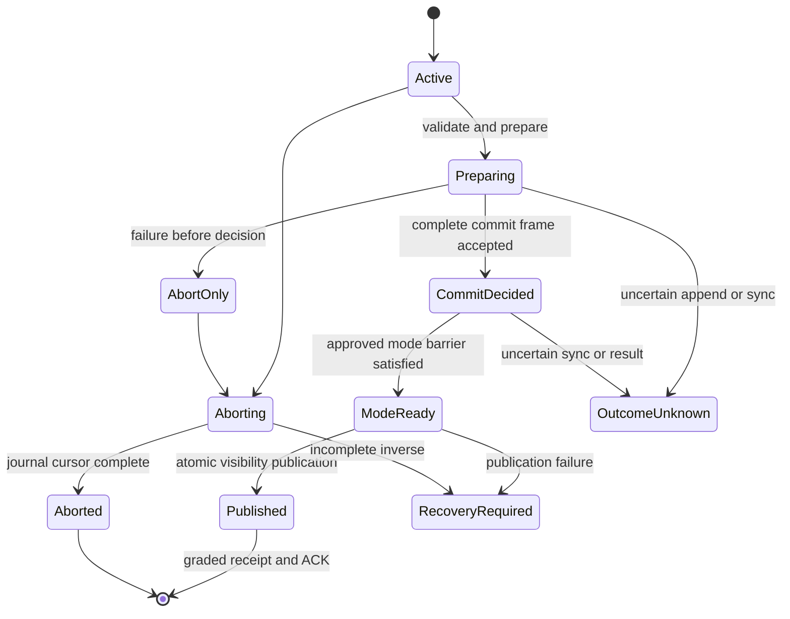

# ADR-410-011 · 稳定身份、唯一恢复与提交/恢复统一契约

source_agent=Codex GPT-6.1 Sol；source_run=RUNTIME-5915-20261120；timestamp=2026-11-20（Asia/Shanghai）；evidence_hash=sha256:57fe60174b4642317a534de402027e42603ba976601a8ed1ff4916cb9fb7df2a；conflict_resolution=属主 2026-11-21 条件批准（7 项补充验收契约冻结前不授权实现）；未实施、未派发、未签产品验收。

Status: CONDITIONALLY_APPROVED（7 项补充验收契约冻结前不授权实现，依 ADR-DECISION-RECORD.md:37，2026-11-21）。Approvals: [ADR-410-001, ADR-410-002, ADR-410-003, ADR-410-004, ADR-410-005, ADR-410-006, ADR-410-007, ADR-410-008, ADR-410-009, ADR-410-010]。Approval: OWNER-DECISION-C-ROUTE（属主 2026-11-21 集中裁决），绑定 sha256:9e9d566aa2174a2950c895654f9b74b16b7c43f000c89b9ca2c53f54810d93a3（BASE=fd849ae20541901d5e59f45cd3ba2c51093f5d5e 下的本 ADR 原文；当前摘要见 handoff/01_ARCHITECTURE_BASELINE.json adrs[].sha256）。依据为e9ff生产源码、PR #5915@56cfa222f1六项独立实跑、#5908/#5909/#5910原件、HARA/ARR与既有ADR-001..010。本文在一份协议中收敛原十稿。规范词“必须”描述批准后的目标，不表示当前实现已具备。

## 1. 选择与否决

选择：**TxStore唯一数据主账和物理mutation/undo所有者 + 事务私有workspace + committed-only持久化基线 + 显式事务WAL/commit/frontier协议**。TM作为唯一事务状态协调者，不再次恢复行。

不选择：①仅给Engine Undo补PK/值定位；②仅去掉Engine Undo而假定leaf完整；③保留共享pending RowStore、只在SELECT侧做MVCC过滤；④把flush当durable commit；⑤清空snapshot后假定剩余WAL含完整历史；⑥旧双Undo作为生产fallback。它们分别遗漏身份、#5910覆盖、#07b落盘、sync、截断和已知数据错误。

可以复用：事务/Savepoint框架、WAL manager/recovery分层、SharedWalHandle、SQL前端、行编码/索引算法和既有测试。不能因已投入slot/RAII原型而免除新协议证明。

## 2. 数据与身份契约

### 2.1 一份权威状态

- Committed RowStore只包含已发布事务的数据，按稳定RowId寻址；SQL表是行多重集，不是按值去重的集合。
- 每事务一个独立TxWorkspace，记录insert/update/delete、预期base版本、约束变更和自身UndoJournal。它是私有暂存，不是第二个可独立对外写的主账。
- MVCC/索引/聚类/缓存是同一commit publication的派生投影；不能接受脱离TxStore的业务写入。读token绑定已发布generation与批准的隔离规则；本事务可合并自己的workspace，其他事务不可读它。
- 所有SQL、Trigger、ODKU、REPLACE、多表DML、LOAD DATA及批准的跨模型写入必须明确参与同一事务协议；缺能力写前拒绝，不能返回空成功。产品功能删减另批。

### 2.2 RowId、MutationId与RowLoc分离

推荐逻辑形状：`RowId=(StoreIncarnation,TableIncarnation,OpaqueRowId)`，具体位宽/分配算法待实现ADR细化。database/table名字解析为稳定OID，drop/recreate必须新incarnation。

1. 每次INSERT出现分配新RowId，同值两行是不同ID；无主键也成立。
2. UPDATE不改RowId，包括业务PK更新；DELETE产生同一RowId的tombstone，rollback/savepoint恢复同一ID和版本，不生成另一条“同值新行”。
3. buffer→table、页移动、压缩、flush、索引重建不改变RowId；Vec下标/page slot只是RowLoc。缓存命中需核验incarnation/version，不能裸下标恢复。
4. 在任何Undo、MVCC snapshot、WAL、复制/PITR仍引用之前不得复用身份；物理slot复用需要generation防ABA。溢出/分配失败写前拒绝，不回绕。
5. **本方案建议已提交行的RowId跨重启保持，并由snapshot与WAL共同携带。** 内存句柄可另带process epoch，但不得替代持久身份。理由是精确重做、重复值、多消费者和跨结构一致性共用一个模型；新测试本身并未逻辑证明必须改磁盘格式。
6. 如果Owner选择不持久化RowId，必须另交等价的事务/操作级redo幂等、重复值、generation替换及消费者身份方案；不能仅说“undo是内存态所以磁盘无影响”。该替代需重新批准本ADR关联部分。

`MutationId=(TxId,StatementId,Ordinal)`标识一次可逆行变更，不是RowId；同一行多次UPDATE有多个MutationId。WAL stream/epoch与TxId不得重启复用成旧身份。

## 3. 唯一Undo、语句原子性与Savepoint

TxStore唯一执行物理变更/撤销，TM/Engine不得在rollback时再次调用SQL delete/insert作为第二层恢复。顶层abort与savepoint共用一份事务journal与不透明cursor；Engine仅维护savepoint名称和语义调用。

每个可逆变更具备：TxContext、MutationId、RowId、旧/新私有状态、预期版本与完整逆操作。prepare先完成可失败资源/容量预留；apply与journal关联在一个不可被外部观察的临界区，任何失败先补偿再返回。RAII仅补偿unwind范围；进程死亡靠workspace隔离与恢复协议。

- rollback严格逆序；成功应用一条才推进已完成cursor。重试相同cursor不能重复修改已完成条目，不能“全部回放后一次清空”而丢进度。
- 找不到目标不等于已撤销；必须有MutationId完成证明或返回RecoveryRequired，不能按值“已存在”跳过。
- 语句失败回到statement cursor；补偿失败进入AbortOnly/RecoveryRequired，拒绝继续commit/DML并保留诊断，不清账后返回Ok。
- RELEASE SAVEPOINT只退名字，不退旧undo；ROLLBACK TO保留此前恢复链，后续顶层abort不二次恢复。
- DELETE-all构造该TxContext视图中的完整RowId变更集（committed视图加自身overlay减自身tombstone），不能只snapshot tables或只snapshot buffer；不得以替换全局表快照覆盖peer commit。TRUNCATE按Owner批准方言语义单列，不能借DELETE-all推导DDL可回滚。

**“只有一个恢复者”是必要结构，不是完整性证明。** Memory/File及所有承诺写入口必须先通过journal覆盖、物理身份和失败原子性出口，才可替换旧路径；禁止仅按后端类型启用单Undo。

## 4. 未提交状态的物理隔离（NO-STEAL）

Workspace与committed RowStore使用不同对象/namespace；普通snapshot、索引、备份、change log/binlog publication和正常loader不可枚举workspace。共享`insert_buffer<Vec<Record>>`即使附tx标签也不能无条件flush进base。

大事务允许有隔离证明的临时spool：不同目录/magic/版本，不能匹配committed表文件loader；它是UNCOMMITTED私有数据，即便写盘也没有可信manifest引用，重启只能丢弃/隔离，不发布为committed。容量/磁盘配额、spill失败和OOM必须有明确AbortOnly/拒绝策略，不能无限涨内存或擅自取消已承诺大事务。

事务所有者由显式TxContext传递，不从全局current_tx_id、当前线程或“最后一个BEGIN”推断。独立引擎/线程/后台flush使用不同上下文，也不能读取或提升对方workspace。创建/恢复句柄必须声明能力；raw PersistenceBackend不得绕过TxStore公开接受事务语义。

## 5. Flush、Commit、Durable Frontier与发布

### 5.1 拆开含混的flush

| 操作 | 允许做的事 | 绝不能证明/触发 |
|---|---|---|
| FlushWorkspace | 私有stage/spool I/O，仍UNCOMMITTED | 不提升committed、不ACK、不推进checkpoint |
| FlushWALBuffer | 将用户态缓冲送到OS | 不等于fsync/durable |
| SyncWAL(target) | 对同一stream/epoch可靠同步并返回durable frontier | 不跨LSN空间比较，不吞错误 |
| FlushCommittedSnapshot | 冻结已发布committed generation，可靠写数据与manifest | 不扫描pending，不只用flush布尔发证书 |
| ReclaimWAL | 按有效证书和consumer floors原子回收 | 不先清空原文件再赌retained重写成功 |

### 5.2 唯一提交协议

1. **Prepare**：冻结workspace/MutationBatch及RowId，预留发布所需资源，验证schema/unique/FK/冲突和批准隔离规则；尚可abort，committed主账不变。
2. **Append**：单一WalService以同一stream/epoch/LSN空间写完整事务redo与commit决定，含TxId、MutationId、RowId、版本和完整性校验。autocommit也是一条真实事务，不能靠“无BEGIN的孤儿DML视为已提交”推断。
3. **Mode barrier**：完整commit frame被接受后进入CommitDecided，尚不必然durable。Every及批准的同步GroupCommit等待`durable_lsn>=commit_lsn`的有效确认；不把append/BufWriter.flush当sync。Batch/Off若保留，可按批准规则在逻辑决定已接受后进入ModeReady，但ACK必须明确较弱等级和损失窗口，不能称DurableCommitted或同等同步持久化。
4. **Publish**：TxStore一次发布committed generation/visibility token，RowStore、MVCC、索引/聚类从同一batch更新。避免逐行对外可见；可失败准备尽量在durable决定前完成。
5. **ACK**：只有模式的durability与publication条件均满足后返回对应CommitReceipt，包含事务结果/级别/stream、commit_lsn、durable_lsn与发布token。

两种锁路径、显式/隐式事务、file/parallel必须调用同一语义协议，不允许复制一套“不sync但也Ok”的fast path。TM的冲突验证不能放到leaf commit或durable决定之后。

### 5.3 失败语义

- Durable决定前明确未写commit且准备失败：abort workspace。
- WAL append/sync报错但无法判定commit决定是否已落盘：OutcomeUnknown/RecoveryRequired；不能断言确定未提交而自动重试新INSERT。已经完整写入但未sync的commit也不能简单撤workspace并返回“确定未提交”，它仍可能在后续恢复被认作提交。
- Commit已durable但publish失败：CommittedPendingPublish/RecoveryRequired，保留redo与结果身份，不转Aborted；恢复完成发布，可按稳定请求/TxId查询，禁止重复生成业务mutation。
- Cleanup/undo失败：仅自己的workspace受损，拒绝该事务继续commit；若committed generation是否被改变无法证明，则隔离写服务，不能报告成功。

## 6. Checkpoint与Recovery的联合证明

定义：D为同stream/epoch durable frontier；P为所有相关已提交决定都完整发布的**连续**frontier，不能取若干已发布事务的最大LSN跨过publish缺口；snapshot的CP必须对应一致的committed视图，且不越过D/P。

Checkpoint顺序：固定generation/CP→写committed数据与身份元数据→同步数据→写并同步临时manifest→原子切换并同步必要目录→验证/返回DurableSnapshotCertificate。证书绑定store/table incarnation、generation、schema、WAL stream/epoch、CP与文件hash，来源是实际I/O/校验结果，非人工布尔。

回收边界同时受证书、active事务最早所需日志、replica与PITR/备份消费者约束。消费者停滞触发容量策略/Owner升级，不悄悄删日志；segment代切换后再退役旧代，任一步中断保留可恢复版本。

Recovery必须：

1. 加载并验证完整可信manifest及其committed generation；拒绝损坏/歧义/不兼容版本，不从原始JSON glob猜基线。
2. 扫描WAL并验证frame/CRC/stream/epoch；只重放有完整commit决定的事务，未提交/abort事务workspace丢弃或隔离。半条WAL/缺事务片段不能凭key或txid缺省升级。
3. 从snapshot CP之后所需日志恢复；按RowId+MutationId/版本或等价持久应用标记做redo幂等。相同行值不是重做已完成的证据，重复值必须保留多重性。
4. 重建与同一恢复视图一致的MVCC/索引/聚类，只有全部必需应用/校验满足才进入Recovered并开放服务；错误不能先标Recovered再二次空Ok。
5. 旧snapshot可能已有未提交脏行且缺owner/commit provenance时，仅过滤WAL不能识别/清除它们。标记LEGACY_BASELINE_UNVERIFIED，需可信备份、完整日志重建或独立oracle核验；不得静默把原有行全部当已提交，也不得为过测试删除不明行。

“清空内存+全WAL replay”仅在可信完整历史、catalog/数据路径及幂等均获证明且日志未被截断时，才可作为隔离重建方法；不是通用Crash Recovery保证。clean reopen、process::exit、SIGKILL和断电是不同故障模型，INV-07b只覆盖前者。

## 7. Storage与TM职责及状态机

| 组件 | 拥有 | 不拥有 |
|---|---|---|
| Engine | SQL/方言、显式TxContext、savepoint名字、结果返回 | 第二份物理Undo、后台默许flush私有行 |
| TransactionManager/Coordinator | 生命周期、冲突/约束决定、prepare/commit/abort编排、typed结果 | 按PK/行值回放SQL来恢复RowStore |
| TxStore | committed主账、workspace、唯一journal/cursor、RowId变更/原子发布 | 自造另一套事务提交决定 |
| PersistenceBackend | committed snapshot/文件IO、能力报告、校验 | 假BEGIN/COMMIT/ROLLBACK、共享pending升级 |
| WalService | 单stream LSN、事务frame、sync frontier、原子segment维护 | 只靠存在一条DML推断commit |
| Recovery | 验证基线与日志、重放/幂等/重建、服务准入 | 把loader读到的所有行当committed |
| MVCC/Index | 经批准read token的可见性与派生投影 | 独立业务主账或第二次物理撤销 |

ModeReady不自动意味着durable：只有满足durable frontier的收据才可声明DurableCommitted。弱模式已决定后publish失败同样不能谎称普通rollback；按分级结果/OutcomeUnknown查询与恢复，且遵守已批准损失窗口。状态的持久化/可查询结果与接收方契约须按模式冻结；不能让TxSession、leaf tx_id、MVCC pending与WAL active分别自定终态。

## 8. 格式影响、验证与Owner门禁

新持久RowId、明确commit frame、snapshot证书可能需要隐藏元数据/sidecar与WAL版本升级；不要求为此重写SQL前端或B+Tree算法，但**不得先承诺零格式变化**。内存slot方案是可比较备选，不是无需验证的退路。

验收出口见04矩阵：保留#5915原六测试；增加身份级oracle、完整mutation覆盖、MVCC/物理联合断言、真实子进程/强杀/恢复调用、ACK与sync边界、checkpoint/reclaim中断、旧数据歧义和重复redo。源装配与故障模型单独计数，任何NOT_RUN/未批准Unsupported不能计PASS。设计者不自签最终认证。

Owner需批准：唯一协调/Undo边界、持久RowId/格式方向、private workspace/大事务预算、隔离/功能范围、durability各模式/OutcomeUnknown、故障模型/迁移RPO、独立Reviewer与实施准入。批准前本包只是技术裁决材料；DSH-A/B仅按正式交接登记待审，不派发核心实现。
