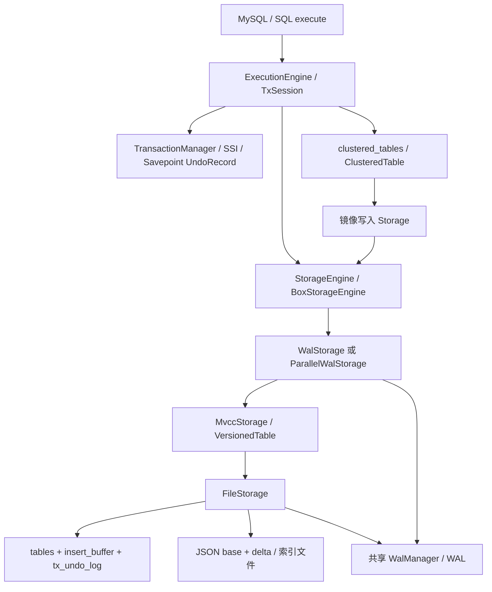

# HARA-410 · 当前内核结构

source_agent=Codex GPT-6.1 Sol；source_run=HARA-410-20261120；timestamp=2026-11-20（Asia/Shanghai）；evidence_hash=sha256:2740d73eb47e3d1f861483d61586ebb7c13387a61148101d36370230175a4f3b（`evidence/enumeration.json`）；conflict_resolution=冻结 e9ff21fca3 源码优先，索引和报告只导航；本文不是完整系统认证。

## 生产构造与模块边界（VERIFIED-CODE）

`crates/mysql-server/src/lib.rs:7428` 按 storage 参数选后端：binary 直接 BinaryTableStorage 且日志写明 no WAL；parallel 构造 ParallelWalStorage<MvccStorage<FileStorage>,…>；默认 file 分支构造共享 WAL 的文件栈。`lib.rs:7451,7515,7594,7679` 是 leaf 与 MVCC 装配锚点。FileStorage 与外层 WAL 使用 SharedWalHandle（`crates/storage/src/wal/mod.rs`）避免两个 writer。根 `src/engine_builder.rs` 的 with_memory、with_wal 等又提供不同组合，测试构造不能替代服务器装配证明。

图仅覆盖实读的 SQL 行存储主路径；图/GMP/向量另有写参与接口，未完整认证。Parallel 及 binary 配置是产品入口可达，而非纯测试类型。

## 数据主账与身份

| 可变结构 | 当前职责与物理位置 | 身份/契约缺口 |
|---|---|---|
| FileStorage.tables | 内存 TableData；落 JSON base/delta | scoped_key(db,table)，行是 Vec 位置；位置不是稳定 ID |
| insert_buffer | 同一表未提升的内存行；scan 合并 | 行值及裸表名 UndoOp；flush 后位置迁移而 undo 未转换 |
| tx_undo_log | FileStorage 物理恢复栈 | tx_id + UndoOp；row_idx/row value，默认库回放 |
| TM UndoRecord | SQL/Trigger 的逻辑恢复栈 | table + PK/旧值/新值，无 database、稳定内部 RowId |
| MvccStorage | pending/committed 版本与每表 snapshot；重启由 inner rebuild | PK/伪身份、reader_tx；与 inner 数据共存并有合并路径 |
| clustered_tables | 引擎内存聚类有序表，SELECT 可直接读取 | 聚类 key；写后再镜像到 Storage，无统一原子 mutation receipt |
| FileStorage indexes / AHI / PK cache | 派生定位和缓存 | 物理位置、page_id 或 key；失效与回滚同步尚无统一协议 |
| BufferPool 模式 | 公共构造可选的独立 page-id 行存储 | insert_at:5034 提前返回；scan:6607 同样走 page 路径，eviction miss 跳过行 |
| WAL | 可重放持久化日志 | LSN + tx_id + table/database + payload；历史格式存在名字缺省兼容 |

这些结构不是全都可互换的缓存。尤其聚类表与 heap 镜像、MVCC 与 inner merge、buffer_pool 提前返回，是不同权威关系；在推荐架构中必须明确主账，不能只把变量改名为 slot。

## 实际事务状态与失败传播

`src/execution_engine_methods.rs:1604` begin 先创建 TM/TxSession 状态，再尝试 lockfree storage begin；`.is_ok()` 混合“不支持”和运行失败，fallback 的 begin 结果被丢弃。

显式 commit:1716 先 storage commit，再 TM.commit；fallback 丢弃 storage.commit_transaction_for 的错误。TM.commit:174 还会执行 SSI validate，故“存储已提交后，TM 可能拒绝”是必须关闭的顺序风险（HYPOTHESIS，尚未跑 SSI 冲突端到端反例）。

隐式 commit:2080 顺序相反：TM.commit 结果被丢弃，再 storage.commit_transaction_for；后者失败时 TM 的 active entry 已移除。DML 中途返回错误是否统一 abort，尚无一个覆盖所有分支的 RAII/状态出口。

显式 rollback:1919 先 leaf undo/discard，再 TM.rollback_with_undo 逐条 delete/insert；错误不能保证保留可重试恢复状态。SAVEPOINT:1795 只截断/回放引擎逻辑 undo，没有统一 leaf/MVCC/WAL savepoint token。

因此当前并不是一台单一状态机：TxSession、TM.active、Storage current_tx_id/TLS、MVCC pending、WAL active_txs 各自推进。Idle/Committed/Aborted 字段存在不等于状态转换被证明。

## WAL → 持久化 → Recovery

`WalStorage::commit_transaction:1154` append Commit、按 sync_mode sync，记录 checkpoint metadata，inner.flush，safe_truncation，inner.commit。`safe_truncation_lsn:335` 取 checkpoint 与 oldest active 首 LSN 的最小值，但缺 durable snapshot 的可验证证书。

`commit_transaction_lockfree_for:1425` append Commit、inner commit、清 tx；没有同步调用，和 &mut 版本不同。FileStorage `save_table_full:1878` 直接 File::create + BufWriter.flush；delta:1922 也只 flush。文件可靠落盘、目录持久化、base/delta 原子切换未在这条调用链建立。WalManager `truncate_before:179` 则先清空原 WAL 再逐条保留重写，没有临时代文件的原子替换。

RecoveryImpl:612 过滤 committed WAL 并执行 redo，不会撤销已写入 base/delta 的未提交行。StatefulRecoveryEngine:99 在 inner.recover 返回前先改为 Recovered，实际失败后会把后续调用当已完成。两者都有本轮独立反例，见 04。

## 隔离与外部消费者

MvccStorage:797 的 scan_in_tx_db 对有绑定 reader_tx 使用 BEGIN 时 snapshot；autocommit 使用新 snapshot。对未绑定 reader，还合并 inner rows，并排除 pending keys。`bind_reader_snapshot:315` 与 per-table 时钟说明隔离证明必须覆盖跨表；不能由语句写锁或类型名推导 Read Committed/SI。

BinlogServer、Replication、PITR 都存在独立状态/事件接口；PITR `pitr.rs:83-182` 以 tx boundaries 和时间过滤 WAL，并调用共享 apply。事务记录、LSN、身份、DDL 格式改动必须将其纳入兼容测试。Binlog→replica→持久化 ACK 的完整生产链及跨模型写入仍 UNREAD/NOT-RUN，不能宣称 ACID 覆盖全产品。

## 分析工具边界

GitNexus CLI 可用，索引对应 cd8cefe，本轮基线是 e9ff21fca3。query 的 FTS 返回只读数据库错误、空流程，不能将空结果当无调用；context 定位了 `execute_transaction→rollback_transaction→TM.rollback_with_undo`，源码又补出了未显示的动态 Storage 分派。原始输出在 gitnexus-*.json。

AOCI 已调用 rules + overview(check_only)。返回 semantic_change_count=1370、governance_aligned=false、current_system_cognition_reliable=false，未读取完整 5285 Entries，不能声称完整系统认知已验证。按用户只读范围未修复索引。本报告的结论限定在已读源码与已跑反例。
