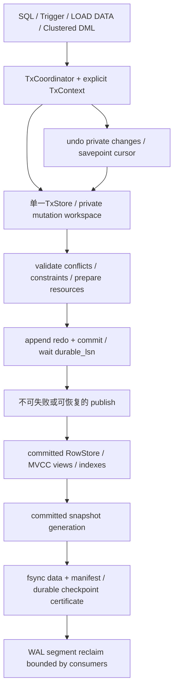
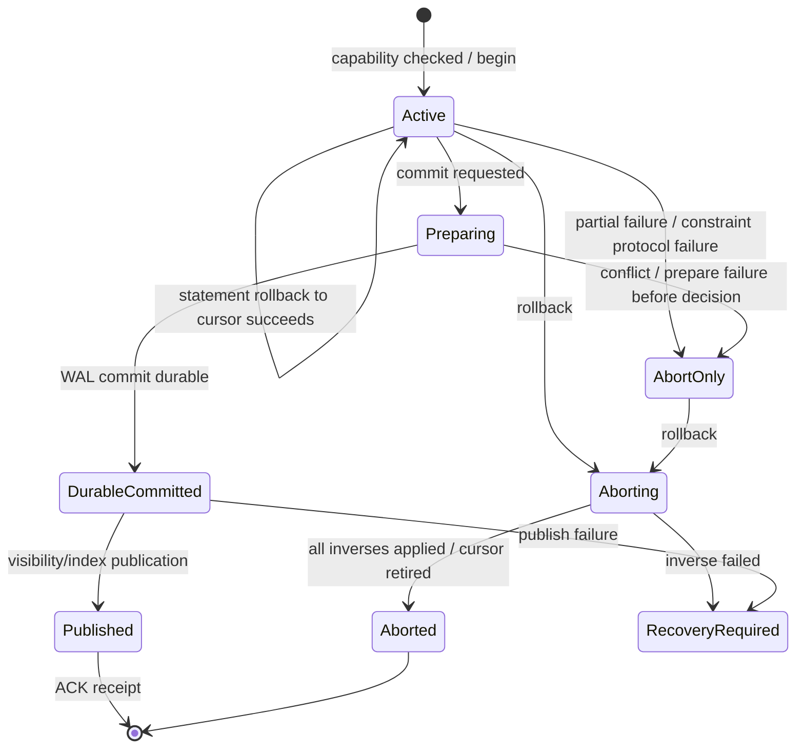

# HARA-410 · C路线实施路线图（设计，未实施）

source_agent=Codex GPT-6.1 Sol；source_run=HARA-410-20261120；timestamp=2026-11-20（Asia/Shanghai）；evidence_hash=sha256:be201d57c2a91d6edf7926665c27e508dfc1bffb67c3294fa811751f33bd8cdd；conflict_resolution=以下均为PROPOSED设计，属主批准前不改正式接口/格式/功能承诺；本轮未实现任何一项。

## 目标主账与责任



数据主账是TxStore的committed RowStore+事务私有workspace。buffer为存放方式，index/clustered view/MVCC read projection为派生状态；不能各自接受独立业务写入。事务唯一物理恢复所有者是TxStore，TM管理协调、隔离验证与状态，不再用SQL delete/insert做第二套undo。

WAL记录可恢复变更与commit决定；Undo负责运行期abort/savepoint；MVCC负责可见性与冲突，不能重新发起独立物理恢复。Checkpoint只能消费已经提交并可靠持久化的generation；Recovery先验证generation/日志完整性，再构造committed状态，再开放读写。

## 身份契约与接口草案

以下是语义签名而非可编译Rust，不是本轮新增代码。

```text
StorageCapabilities {
  statement_atomic, explicit_transactions, savepoints,
  supported_isolation_set, durable_commit, recovery_protocol_version,
  namespace_support, mutation_protocol_version
}
TxContext { database_id, tx_id, process_epoch, snapshot_token, isolation }
RowId { table_id, incarnation, sequence_or_slot, generation }
OperationId { tx_id, ordinal }

begin(requested_capabilities, isolation) -> TxHandle | UnsupportedBeforeWrite
scan(read_context, table_id, access_path) -> SnapshotRows
apply(tx_handle, mutation_batch) -> MutationReceipt
savepoint(tx_handle) -> UndoCursor
rollback_to(tx_handle, cursor) -> UndoProgress | AbortOnly | RecoveryRequired
abort(tx_handle) -> AbortedReceipt | RecoveryRequired
prepare(tx_handle) -> PreparedCommit | ConflictBeforeDurableDecision
commit(prepared, durability_policy) -> CommitReceipt(commit_lsn, durable_lsn)
checkpoint(committed_generation) -> DurableSnapshotCertificate
reclaim_wal(certificate, active_tx_floor, replica_floor, pitr_floor) -> ReclaimReceipt
recover(manifest, wal_segments) -> VerifiedBaseline | RecoveryRequired
```

能力是独立维度，不能排成“有savepoint就一定durable”的线性等级。wrapper只能组合经验证的能力：WAL能增加durability，但不能凭空增加inner的rollback。明确拒绝Unsupported，与IO失败、约束冲突、OutcomeUnknown分离。非事务后端不可接受一个随后无法兑现的BEGIN。

RowId不同于PK、物理下标和OperationId；UPDATE主键不改RowId，DELETE/undo恢复同一RowId；迁移/压缩一起携带ID；旧引用失效前不可复用slot，复用需generation。内存epoch可仅进程有效；跨重启稳定性取决于选定恢复协议。重复值必须有独立身份或持久化operation去重依据，不能用“相同行已存在”判redo已应用。

## 事务状态机



Commit变为durable以后不能再宣称rollback成功，也不能返回普通“未提交”错误让调用方盲重试；需OutcomeUnknown/已提交待恢复的明确结果。冲突验证放在durable决定之前。undo成功一条才推进可重试cursor，避免“全部应用后统一retire”导致重放两次。panic补偿只覆盖unwind，进程退出的安全来自NO-STEAL/恢复协议。

## 冻结顺序与PR依赖

| 阶段 / 建议PR批次 | 最小交付物与触及模块 | 可证伪出口 | 阻断与关联 |
|---|---|---|---|
| M-Pre补证（PR0只测试/证据） | 冻结版本、能力/隔离/格式承诺、默认+parallel强杀harness | F01–F10旧实现必红；SIGKILL点必须有父子handshake；无fixture=NOT-RUN | R1、#5584/#5376；未闭合不得批准正式M0 |
| M0契约（PR1） | TxContext/RowId/capabilities/error/commit协议ADR及参考contract tests；engine.rs/TM边界 | Unsupported在副作用前、错误类型互斥、同tx不会混旧协议 | 属主先选隔离/格式/非事务后端产品范围；Reviewer审签 |
| M1单一行变更与undo（PR2a/2b） | File/Memory的RowId+workspace+savepoint；统一变更入口；六类buffer修改点 | 同值不同事务、PK变更、删除压缩、flush/threshold/peer、savepoint；新绿/变异红 | 5891/5896/5897/5905/5906/5908/5909/5910/5911，逐ID记录 |
| M2 durable commit/recovery（PR3a/3b/3c） | WAL两种锁路径合一；FBWM segment原子切换；committed-only snapshot及manifest；Recovery状态机 | F03/F04/F07；每个durability边界崩溃；第N次sync失败；recovery失败不可变空成功 | F08、#5584；durable证书不能是人工布尔claim |
| M3 MVCC与索引发布（PR4a/4b） | row identity贯通MVCC；读token/版本GC；二级索引/聚类视图由TxStore发布 | 脏读、自写可见、快照/RC按批准承诺、并发冲突、主键改动、回滚后索引一致 | #5412/#5507；不得用语句锁代替隔离测试 |
| M4全部写入口/后端（PR5a/5b/5c） | REPLACE/ODKU/多表/Trigger/TRUNCATE/LOAD DATA；binary/append/table-level适配；Box/Vtu/Parallel装配 | 同一SQL oracle跨支持矩阵；第N行/表/trigger失败无部分发布；拒绝组合在启动前 | F06/F09/F10；不自行删已承诺功能 |
| M5兼容与消费者（PR6） | 旧JSON/delta/WAL读取；PITR/binlog/replication/备份watermark适配 | 多版本升级/恢复、同值重复、重做幂等；replica/PITR不得引用已回收日志 | 字节格式如变需独立迁移PR与owner审批 |
| M6集成认证（PR7证据） | CI负向夹具、冻结组合态、分层SOAK/性能、独立review回执 | 新引擎+全部支持配置+恢复/迁移完整矩阵，无silent skip | AB-01..AB-10、STAGE_CONFIG，阶段跃迁由属主 |

依赖为 PR0→PR1；PR2是PR3/4接口前提；PR3与PR4均完成后才能做PR5组合；PR6依赖协议/格式冻结，PR7最后。局部前端/CI基础设施修复可以独立排队，但不得触碰被冻结接口或共享认证任务。设计时允许并行分析，合并依赖不能并发猜测。

## 保留、替换、废弃与工作量

保留：parser/planner主框架、现有SQL corpus与历史反例、行编码中可兼容部分、B+Tree算法、SharedWalHandle、WAL codec/recovery分层。替换：双层物理undo、implicit全局tx所属、以行值判撤销/redo完成、在inner失败时照样retire/publish、未提交snapshot。迁移后废弃：旧事务默认转发/裸入口、旧双undo发布开关、按同值次序定位、假成功后端声明。

影响面下界来自05枚举的6 leaf+5 wrapper，外加SQL engine/TM、恢复/WAL与consumer。重点回归家族至少包括：身份/多重集、savepoint、所有DML原子性、错误注入、隔离、commit durability、checkpoint/reclaim、重启幂等、历史迁移、索引/缓存、复制/PITR。具体用例数量取决于批准的backend×语句×边界矩阵，不能凭空换算精确人天。

## 失败与回退

每个阶段保存冻结commit、接口版本、数据格式generation和完整evidence manifest。旧双层undo仅离线对照，不出现在可发布开关里。M1未完成时不混用新旧mutation；M2持久化证据不成立时拒绝开启durable写服务；回退目标只能是通过相同不变量的前一冻结版本，若不存在则停止写入、保留WAL/数据快照供恢复。

迁移在数据副本上进行，原备份只读保留；先验证可恢复、再切换manifest/二进制。新格式已写入后旧程序必须拒绝启动，而不是猜测降级。任何“回滚应用版本”都不能隐含对磁盘数据逆迁移；恢复备份的业务数据时间损失须属主预先接受。

## ALPHA→BETA最终要求

权威判据是当前 `docs/governance/STAGE_CONFIG.yaml` 与 `docs/releases/v4.1.0/ALPHA_TO_BETA_GATE_PLAN.md`，需核对其临时裁决及deferral，不由本报告重写阈值。必要技术证据：R1每个ID原反例、所有承诺后端/DML、默认与parallel实际wire客户端、隔离和崩溃恢复、旧数据升级/备份恢复/复制PITR、反向变异、全仓规定测试/Clippy/fmt、冻结提交全部阶段门禁及独立Reviewer+属主批准。

SOAK按既有阶段规定执行，真实时长/独占性/错误归因必须可核对；不得把本轮短反例或文档存在当SOAK。任何NOT-RUN/UNREAD都列为缺口，不能凑通过比例。尚无证据允许本轮结束ALPHA。
