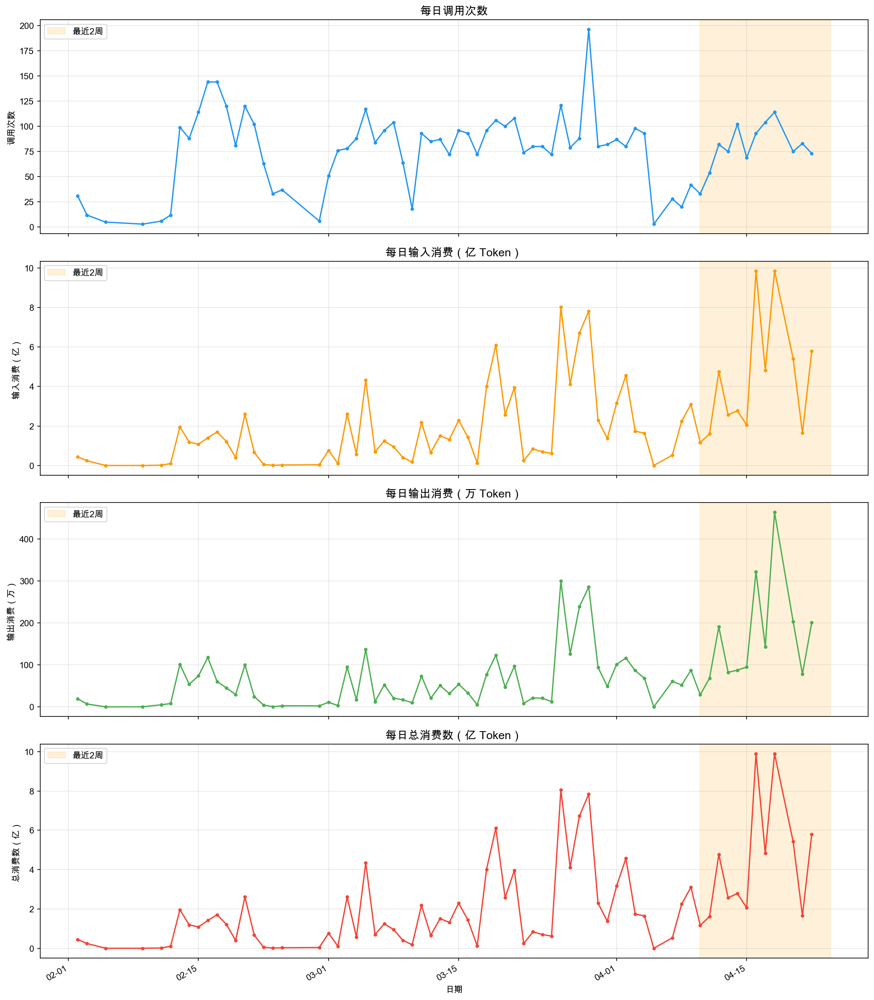
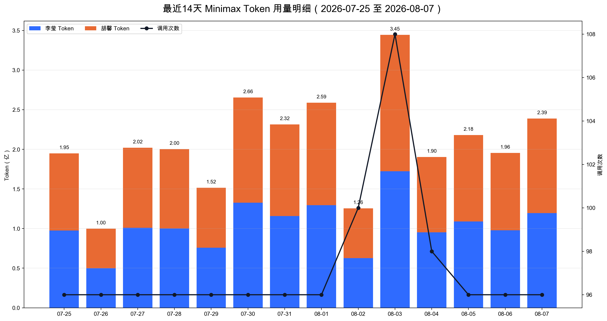

# SQLRustGo 项目分析报告

**报告生成日期**: 2026-05-30
**数据范围**: 2026-04-01 至 2026-05-29
**上次更新**: 2026-04-24

## 1. Minimax 套餐用量分析

### 1.1 数据概览

| 指标 | 数值 |
|------|------|
| 数据范围 | 2026-04-01 至 2026-05-29 |
| 总记录天数 | 59 天 |
| 总记录数 | 5,405 条 |
| 主要模型 | MiniMax-M2.7-highspeed, MiniMax-M2.7, MiniMax-M2.5-highspeed, MiniMax-M2.1, MiniMax-M2.1-highspeed, coding-plan-search |
| 最高峰值日 | 05-14（12.37亿，100次调用） |
| 次高峰值日 | 05-03（11.73亿，158次调用） |
| 4月总用量 | 93.99亿 |
| 5月总用量（至29日） | 140.12亿 |
| 总体日均用量 | 3.97亿 |
| 最近2周日均用量 | 4.14亿 |

### 1.2 用量趋势分析

#### 总体 Token 用量趋势

#### 最近2周详细用量

### 1.3 月度用量对比

| 月份 | 总 Token 用量 | 输入消费 | 输出消费 | 调用次数 | 日均用量 |
|------|-------------|----------|----------|----------|----------|
| 2026-04 | 93.99亿 | 93.65亿 | 3384.5万 | 2,056 | 3.13亿 |
| 2026-05（至29日） | 140.12亿 | 139.46亿 | 6655.3万 | 3,349 | 4.52亿 |

**月度对比分析**:
- 按当前速率预估2026-05全月总消费约 124.25亿 Token
- 输出消费持续增长，代码生成活动活跃

### 1.4 最近2周用量分析（05-16至05-29日）

| 日期 | 调用次数 | 输入消费 | 输出消费 | 总 Token 用量 |
|------|----------|----------|----------|-------------|
| 2026-05-16 | 117 | 4.32亿 | 160.6万 | 4.34亿 |
| 2026-05-17 | 133 | 4.37亿 | 197.3万 | 4.39亿 |
| 2026-05-18 | 91 | 4.99亿 | 208.5万 | 5.01亿 |
| 2026-05-19 | 84 | 2.07亿 | 133.3万 | 2.08亿 |
| 2026-05-20 | 72 | 1.32亿 | 118.1万 | 1.33亿 |
| 2026-05-21 | 89 | 4.04亿 | 222.4万 | 4.06亿 |
| 2026-05-22 | 164 | 5.79亿 | 405.3万 | 5.83亿 |
| 2026-05-23 | 165 | 4.34亿 | 312.0万 | 4.37亿 |
| 2026-05-24 | 161 | 5.45亿 | 324.6万 | 5.48亿 |
| 2026-05-25 | 133 | 3.21亿 | 251.9万 | 3.24亿 |
| 2026-05-26 | 126 | 3.34亿 | 244.0万 | 3.37亿 |
| 2026-05-27 | 148 | 2.86亿 | 213.0万 | 2.88亿 |
| 2026-05-28 | 138 | 3.22亿 | 241.3万 | 3.25亿 |
| 2026-05-29 | 182 | 8.31亿 | 560.7万 | 8.37亿 |
| **合计** | **1,803** | **57.62亿** | **3593.0万** | **57.98亿** |

**最近2周统计指标**:
- 日均调用次数: 129 次
- 日均输入消费: 4.12 亿 Token
- 日均输出消费: 256.6 万 Token
- 日均总消费数: 4.14 亿 Token

### 1.5 最近2周 vs 前2周对比

| 指标 | 前2周日均 | 最近2周日均 | 变化幅度 |
|------|----------|-----------|----------|
| 调用次数 | 104 | 129 | +24.3% |
| 输出消费 | 203.9万 | 256.6万 | +25.9% |
| 总消费数 | 5.42亿 | 4.14亿 | -23.6% |

**对比分析**: 最近2周总消费数较前2周变化-23.6%，输出消费变化+25.9%

### 1.6 模型使用分布（最近2周）

| 模型 | 调用次数 | 占比 | 输入消费 | 输出消费 | 总消费数 |
|------|----------|------|----------|----------|----------|
| MiniMax-M2.7-highspeed | 936 | 51.9% | 33.72亿 | 2113.9万 | 33.93亿 |
| MiniMax-M2.7 | 736 | 40.8% | 22.81亿 | 1413.5万 | 22.95亿 |
| MiniMax-M2.5-highspeed | 30 | 1.7% | 1.04亿 | 26.5万 | 1.04亿 |
| MiniMax-M2.1 | 10 | 0.6% | 0.04亿 | 3.7万 | 0.04亿 |
| MiniMax-M2.1-highspeed | 89 | 4.9% | 0.01亿 | 35.5万 | 0.01亿 |
| coding-plan-search | 2 | 0.1% | 0.00亿 | 0.0万 | 0.00亿 |

**模型分析**: 各模型使用分布情况

### 1.7 接口使用分布（最近2周）

| 接口 | 调用次数 | 占比 | 总消费数 |
|------|----------|------|----------|
| cache-read(Text API) | 685 | 38.0% | 39.97亿 |
| chatcompletion-v2(Text API) | 688 | 38.2% | 15.83亿 |
| cache-create(Text API) | 428 | 23.7% | 2.19亿 |
| code_plan_resource_package | 2 | 0.1% | 0.00亿 |

**接口分析**: 各接口使用分布情况

### 1.8 用量波动分析（最近2周）

| 指标 | 数值 |
|------|------|
| 最高用量日 | 05-29 — 8.37亿（182次调用） |
| 最低用量日 | 05-20 — 1.33亿（72次调用） |
| 标准差 | 1.74亿 |
| 变异系数 | 42.0% |
| 峰谷比 | 6.3x |

**按星期分布**:

| 星期 | 日均总消费 | 日均调用次数 |
|------|-----------|-------------|
| 周一 | 4.12亿 | 112 |
| 周二 | 2.72亿 | 105 |
| 周三 | 2.10亿 | 110 |
| 周四 | 3.66亿 | 114 |
| 周五 | 7.10亿 | 173 |
| 周六 | 4.35亿 | 141 |
| 周日 | 4.93亿 | 147 |

## 2. 项目 PR 和版本分析

### 2.1 版本分支完整列表

(请根据实际Git分支数据更新此部分)

### 2.2 版本时间跨度分析

(请根据实际Git分支数据更新此部分)

### 2.3 版本 PR 数量分析

(请根据实际Git分支数据更新此部分)

### 2.4 最近 PR 活动

(请根据实际Git分支数据更新此部分)

### 2.5 分支策略分析

(请根据实际Git分支数据更新此部分)

## 3. 项目发展趋势分析

### 3.1 用量趋势洞察

1. **用量持续高位**: 最近2周日均4.14亿 token，持续高活跃度
2. **输出消费变化**: 输出消费变化+25.9%
3. **调用频率**: 最近2周日均129次调用
4. **峰谷波动**: 变异系数42.0%，峰谷比6.3x

### 3.2 版本演进洞察

(请根据实际Git分支数据更新此部分)

### 3.3 PR 活动洞察

(请根据实际Git分支数据更新此部分)

## 4. 结论与建议

### 4.1 结论

1. **项目活跃度**: 从最近2周用量数据来看，项目处于持续开发状态
2. **资源使用**: Minimax套餐用量与项目开发强度匹配
3. **趋势预测**: 按当前速率预估月用量约 124.25亿 Token
4. **调用额度**: 按当前速率预估月调用 3,864次，在Coding Plan 4,500次额度内

### 4.2 建议

1. **资源监控**: 建议持续关注用量变化
2. **版本规划**: 建议保持当前开发节奏
3. **缓存优化**: 继续保持缓存策略以提高效率

## 5. 附件

### 5.1 数据文件

- `artifacts/usage/export_merged_20260530.csv` - 合并后的原始用量数据
- `scripts/usage/minimax_usage_summary.xlsx` - 详细汇总数据

### 5.2 图表文件

- `scripts/usage/minimax_usage_trend.png` - 总体用量趋势图
- `scripts/usage/minimax_2weeks_detail.png` - 最近2周详细柱状图

### 5.3 分析脚本

- `scripts/analyze_new_data.py` - 新数据综合分析脚本

---

**报告生成工具**: 基于Python脚本分析生成
**分析范围**: Minimax套餐用量（低速+高速）
**数据来源**: export_bill_低速套餐4-5.csv + export_bill_高速套餐4-5.csv

---

*变更记录*
- 2026-04-20: 初始报告，数据范围02-02至04-18
- 2026-04-24: 更新报告，数据范围扩展至04-22
- 2026-05-30: 更新报告，数据范围扩展至2026-05-29，合并低速和高速套餐数据
